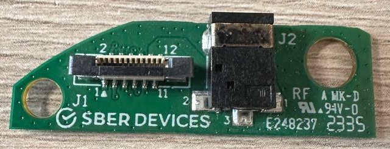
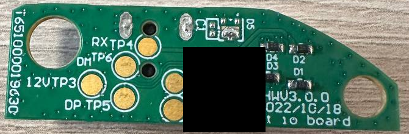
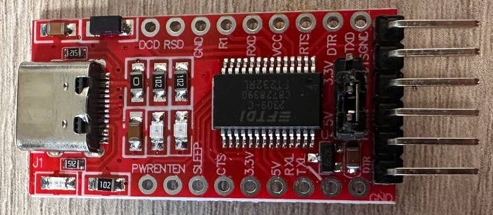
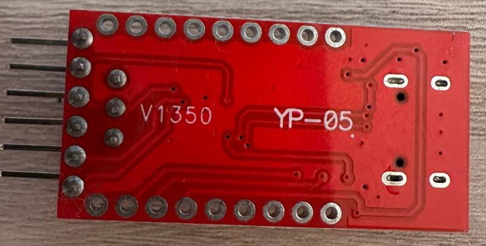

# Платы и фотографии

## Идентификация

- По исторической памятке: первый SberBoom Mini, семейство SBDV-00095. Не Mini 2 / SBDV-00250.
- IO-плата: `Sber Swift io board`, HWV3.0.0, дата 2022/10/18; на фото виден P/N T651000019330.
- На дополнительном фото основной платы из чата: `SWIFT Main Board`, HW 3.0.0 MP, P/N T651000018930, дата 20221021, маркировка Amlogic A113L. Исходного файла этого фото в пакете нет; происхождение нужно уточнить перед перепубликацией.
- Лог загрузки называет чип A1 Rev A. Не использовать совпадение имён SoC как доказательство совместимости boot-ROM exploit.

## Галерея

Файлы получены от владельца через Telegram; перед публикацией обрезан фон, удалены метаданные, на IO-фото непрозрачно закрыты наклейка с QR/идентификаторами. Смысловая информация на плате не дорисовывалась.

### IO-плата, разъём питания и шлейф

### IO-плата, тестовые площадки

На этом исходном фото наклейка скрывает подписи TP1/TP2. Их назначение прочитано на другом фото из чата **после снятия наклейки**; исходник этого дополнительного фото пока не включён. Отсутствующие подписи на изображение не наносились.

### USB–UART, компонентная сторона

### USB–UART, обратная сторона

## Площадки IO-платы

| Площадка | Подпись / назначение | Статус |
|---|---|---|
| TP1 | GND | Прочитано на дополнительном фото; использовано как земля при читаемом UART |
| TP2 | TX | Прочитано на дополнительном фото; получен boot log |
| TP3 | 12V | Подпись, питание; к USB/UART не подключать |
| TP4 | RX | Подпись; в первом UART-тесте не подключался |
| TP5 | DP | Подпись USB D+; фактическая USB enumeration не получена |
| TP6 | DM | Подпись USB D−; фактическая USB enumeration не получена |

Распиновка применима только к показанной плате/ревизии, не ко всем SberBoom.

## Что реально сработало

При отключённом питании соединяли TP1 с GND адаптера и TP2 с RX адаптера. Колонка питалась штатным блоком. 115200 8N1, flow control none — скорость подтверждена читаемым логом.

TP2 имел около 3,3 В по мультиметру. Это не измерение формы импульсов и не подтверждение уровня TX адаптера. Перемычка 3,3/5 В на YP-05 не гарантирует переключение всех логических уровней.

## Безопасность и неизвестные

- TP2 — выход сигнала, **не питание 3,3 В**.
- Не подавать USB +5 В на TP2/TP3 или неизвестные TP.
- Не питать колонку от VCC USB–UART.
- Не применять RS-232/±12 В или 5-вольтовый TX.
- Проверять назначение жил USB прозвонкой, не только цветом.
- Пробный USB-тест без VBUS не является готовой или полной схемой подключения.
- Не установлены точка USB VBUS detection и допустимые параметры её входа. Следующий шаг — схема/прозвонка, а не подключение +5 В наугад.
- Не документированы разборка основного корпуса, обратная сторона основной PCB, фактическая пайка USB, замеры целостности D+/D−.
- Не входили в BootROM и не замыкали NAND/test points.
